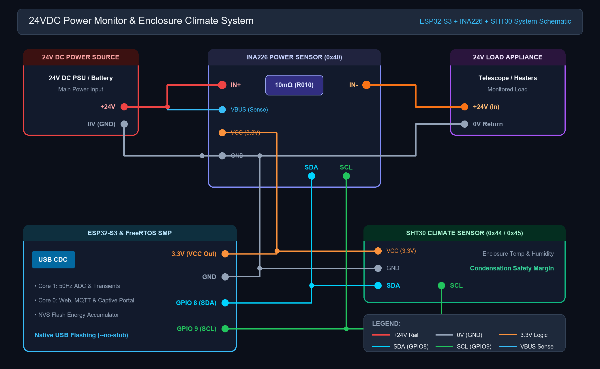
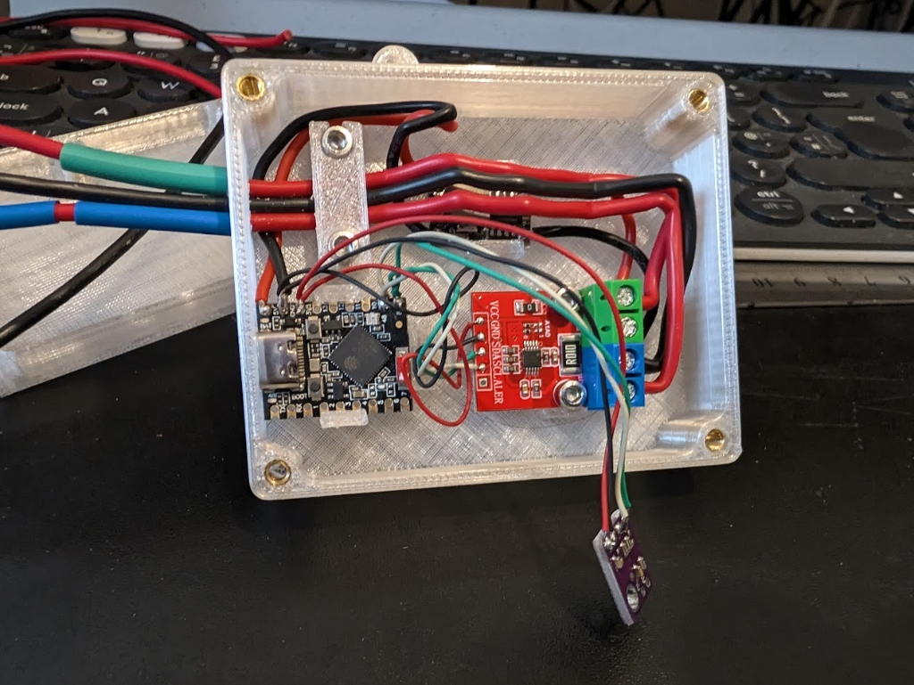
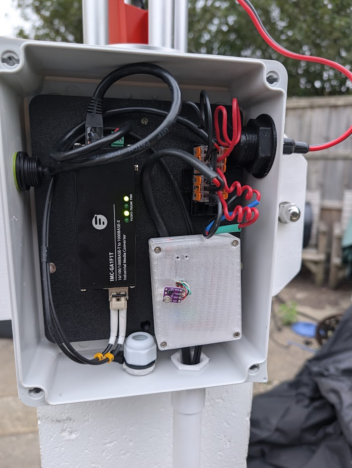

# 24VDC Industrial Power Distribution & Enclosure Environmental Monitor

[](https://platformio.org/)
[](https://www.espressif.com/)
[](https://www.freertos.org/)
[](LICENSE)

An industrial-grade 24VDC power quality, energy accumulator, and enclosure climate monitoring system built on the **ESP32-S3** with **INA226** (high-side bidirectional current/voltage sensor) and **SHT30** (precision temperature/humidity sensor).

---

## ⚡ Features

- **Dual-Core FreeRTOS Architecture**:
  - **Core 1 (Priority 3 - 50 Hz)**: Real-time ADC sampling, high-frequency voltage transient/dip capture, Coulomb counter integration (Ah, Wh).
  - **Core 0 (Priority 1)**: Asynchronous Web Server, REST API, DNS Captive Portal, mDNS, and OTA updates.
- **Power Quality & Voltage Transient Analytics**:
  - Peak-to-peak bus voltage ripple (Vpp in mV).
  - High-speed transient dip detection (< 22.5V with 0.3V hysteresis) and lowest dip capture.
  - Surge event tracking (> 26.5V).
  - Real-time headroom indicator to industrial 21.6V undervoltage cutoff (PLC standard).
- **Current Dynamics & Shunt Analytics**:
  - Precision 16-bit current sensing with 0.25 mA resolution across a 10 mΩ (`R010`) high-side shunt.
  - Peak-to-peak load current ripple (Ipp in mA) over rolling 1-second windows.
  - 1-minute rolling average filtered load current (A).
  - Real-time shunt drop (mV) and I²R thermal dissipation tracking (mW).
  - Hardware peak current ($I_{\text{peak}}$) capture.
  - 1-minute rolling average power filter & extrapolated monthly consumption (kWh).
- **Energy Accumulation with Non-Volatile Persistence (NVS)**:
  - Total Lifetime Energy (kWh) stored across reboots in ESP32 NVS flash.
  - Session Charge (Ah) and Session Energy (Wh) counters since boot.
- **Enclosure Climate & Condensation Safety Margin**:
  - Accurate Temperature & Relative Humidity.
  - Real-time Dew Point calculation using the Magnus formula.
  - **Condensation Margin (ΔT = Tenclosure - Tdew_point)** alerting against moisture risk on terminals/PCBs.
- **Resilient Wi-Fi Auto-Reconnect & Connection Drop Watchdog**:
  - Continuous network watchdog monitors Wi-Fi connection health in real time.
  - Automatically re-initiates connection every 5 seconds upon signal loss or router reboot.
  - Tracks Wi-Fi disconnect/drop events since boot (`wifi_drops`).
  - Graceful fallback SoftAP does not block STA background retries.
- **Zero-Config Fallback Captive Portal**:
  - If Wi-Fi is unconfigured or out of range, the device broadcasts `PowerMonitor-Setup`.
  - Embedded DNS server automatically launches the Wi-Fi setup captive portal (`192.168.4.1/setup`) on iOS, Android, and Windows.
  - Scans and lists 2.4GHz networks with signal strength (RSSI).
  - Selected Wi-Fi credentials are saved to persistent NVS storage.
- **MQTT Telemetry & LWT Status Tracking**:
  - Automatically publishes real-time JSON telemetry to base topic prefix `telescope/` (e.g. `telescope/pmon`).
  - **Last Will and Testament (LWT)**: Retains `Offline` on broker disconnection; retains `Online` on `tele/pmon/LWT` when active.
  - Fully configurable device name, broker host, port, username, password, base topic, and interval via `/setup`.
- **Modern Responsive Web Dashboard**:
  - Glassmorphism dark UI with live rolling SVG charts (no external cloud/CDN dependencies).
  - Instant OTA firmware upload form (`/update`).
  - REST JSON API (`/api/data`).

---

## 🔌 Hardware Connection & Wiring

### Bill of Materials (BOM)
1. **ESP32-S3 Mini / DevKit** (4MB Flash, Native USB CDC).
2. **INA226 I²C Power Monitor Module** (with 10 mΩ / `R010` shunt resistor).
3. **SHT30 I²C Temperature & Humidity Sensor** (Wemos D1 shield or standalone module).
4. Pull-up resistors for I²C (4.7 kΩ to 3.3V on SDA/SCL if not onboard).

---

### Complete System Wiring Schematic



---

### INA226 High-Side Shunt & Bus Voltage Connections

> [!IMPORTANT]
> The INA226 measures **High-Side** current on the +24V supply line before the load. Connect **VBUS** directly to the +24V input rail so it can monitor total bus voltage and transient dips.

| INA226 Pin | Connects To | Description |
| :--- | :--- | :--- |
| **VCC** | ESP32 `3.3V` | Sensor digital supply (3.3V) |
| **GND** | ESP32 `GND` & Power Supply `0V` | Common System Ground Reference |
| **SDA** | ESP32 `GPIO 8` | I²C Data Line |
| **SCL** | ESP32 `GPIO 9` | I²C Clock Line (100kHz) |
| **IN+** | 24V Supply Positive (+) | High-side Shunt Input |
| **IN-** | 24V Load Positive (+) | High-side Shunt Output to Load |
| **VBUS**| 24V Supply Positive (+) | 24V Bus Voltage Sensing Lead |

---

### SHT30 Enclosure Sensor Connection

| SHT30 Pin | Connects To | Notes |
| :--- | :--- | :--- |
| **VCC** | ESP32 `3.3V` | 3.3V Power |
| **GND** | ESP32 `GND` | Ground |
| **SDA** | ESP32 `GPIO 8` | Shared I²C bus |
| **SCL** | ESP32 `GPIO 9` | Shared I²C bus |
| **ADDR**| Floating / GND / 3.3V | Auto-probed at `0x44` (default) or `0x45` (shield) |

---

## 📸 Finished Build & Installation

| Internal Electronics Assembly | Field Enclosure Deployment |
| :---: | :---: |
|  |  |
| *Custom 3D-printed sub-chassis housing ESP32-S3, INA226 current/voltage monitor, step-down regulator, and external SHT30 sensor lead.* | *Field-deployed weatherproof enclosure with industrial fiber media converter, power distribution blocks, cable glands, and lid-mounted SHT30 climate sensor.* |

---

## 🚀 Getting Started

### 1. Build and Flash with PlatformIO
Clone the repository and flash via USB:

```powershell
# Clone repo
git clone https://github.com/oldjiberjaber/powermonitor.git
cd powermonitor

# Compile and upload to ESP32-S3 over USB CDC
pio run -e esp32-s3-devkitc-1 -t upload
```

### 2. Wi-Fi & MQTT Configuration
1. **Initial Provisioning (Captive Portal):**
   - On initial power-up (or when Wi-Fi is unconfigured), the device broadcasts:
     ```
     PowerMonitor-Setup
     ```
   - Connect your phone or laptop to `PowerMonitor-Setup` and navigate to `http://192.168.4.1/setup`.
   - Select your 2.4GHz Wi-Fi network, enter credentials, and click **Save Wi-Fi & Reconnect**.
2. **Dedicated Settings Pages:**
   - **Wi-Fi Settings (`/setup`):** Scan, select, and configure Wi-Fi SSID and password.
   - **MQTT & LWT Settings (`/mqtt`):** Configure Device Name (LWT identifier), base topic, broker host/IP, port, username, and password independently without rebooting the microcontroller.
   - Direct links to both configuration pages are available in the dashboard bottom bar.

### 3. Accessing the Dashboard
- **mDNS Hostname:** `http://powermonitor.local`
- **Assigned Local IP:** Displayed in the serial monitor (115200 baud) and on your router's DHCP list.

---

## 🛰️ MQTT Topics & Telemetry Specification

### 1. Availability / LWT (`tele/<device_name>/LWT`)
- **Default LWT Topic:** `tele/pmon/LWT` (where `pmon` is the configurable Device Name)
- **Online Payload:** `"Online"` (Retained: `true`, QoS: `1`)
- **Offline Payload (LWT):** `"Offline"` (Retained: `true`, QoS: `1`)

### 2. Live Telemetry (`telescope/<device_name>`)
- **Default Telemetry Topic:** `telescope/pmon` (published every 2 seconds)
- **Consolidated JSON Payload:**

```json
{
  "device": "pmon",
  "voltage": 24.12,
  "shunt_mv": 0.85,
  "current": 0.085,
  "power": 2.05,
  "energy_wh": 14.82,
  "total_kwh": 0.0148,
  "session_wh": 1.25,
  "session_ah": 0.052,
  "v_ripple_mv": 12.5,
  "i_ripple_ma": 4.2,
  "avg_power_1m": 2.02,
  "avg_current_1m": 0.084,
  "projected_kwh_month": 1.48,
  "shunt_loss_mw": 0.072,
  "temperature": 24.8,
  "humidity": 45.2,
  "dew_point": 12.1,
  "condensation_margin_c": 12.7,
  "peak_voltage": 24.35,
  "lowest_dip_v": 23.90,
  "dip_count": 0,
  "surge_count": 0,
  "last_dip_depth_v": 23.90,
  "peak_current": 0.54,
  "peak_power": 13.0,
  "uptime_sec": 3600,
  "wifi_rssi": -62,
  "wifi_drops": 0,
  "free_heap": 241160
}
```

---

## 📡 REST API Reference

The monitor exposes a lightweight JSON API endpoint polled by the frontend:

### `GET /api/data`
Returns electrical telemetry, transient statistics, enclosure climate, and MQTT status:

```json
{
  "voltage": 24.12,
  "shunt_mv": 0.85,
  "current": 0.085,
  "power": 2.05,
  "energy_wh": 14.82,
  "total_kwh": 0.0148,
  "session_wh": 1.25,
  "session_ah": 0.052,
  "v_ripple_mv": 12.5,
  "i_ripple_ma": 4.2,
  "avg_power_1m": 2.02,
  "avg_current_1m": 0.084,
  "projected_kwh_month": 1.48,
  "shunt_loss_mw": 0.072,
  "temperature": 24.8,
  "humidity": 45.2,
  "dew_point": 12.1,
  "condensation_margin_c": 12.7,
  "peak_voltage": 24.35,
  "lowest_dip_v": 23.90,
  "dip_count": 0,
  "surge_count": 0,
  "peak_current": 0.54,
  "peak_power": 13.0,
  "ina_status": true,
  "sht_status": true,
  "sht_addr": 69,
  "uptime_str": "1d 4h 12m",
  "ssid": "MyWiFiNetwork",
  "wifi_rssi": -62,
  "wifi_drops": 0,
  "mqtt_connected": true,
  "mqtt_server": "192.168.0.2",
  "mqtt_topic": "telescope/",
  "version": "v1.9.2-RTOS",
  "build_date": "Nov 20 2026",
  "build_time": "16:50:00",
  "free_heap": 241160,
  "i2c_devices": [64, 69]
}
```

### `POST /api/reset-energy`
Resets the non-volatile cumulative energy accumulator and session counters.

### `POST /api/reset-stats`
Resets the transient peak/dip min/max voltage records, current peaks, and dip event counters.

### `POST /api/reset-peak-power`
Resets the recorded peak power watermark to the current instantaneous load power.

### `POST /api/reboot`
Safely commits cumulative energy counters to NVS flash and restarts the ESP32-S3 microcontroller.

---

## 📄 License
This project is licensed under the MIT License.
